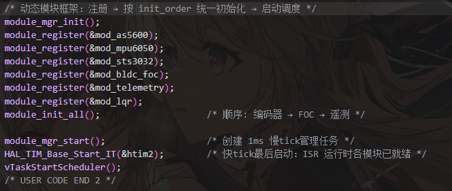

在写代码的时候发现了一个有关调用freertos的小bug，主要表现是会让时钟基准卡死，uwTick不能自增，然后碰到HAL_Delay就会卡死


最后发现的问题是在开启调度器前使用了`taskENTER_CRITICAL()`和`taskEXIT_CRITICAL()`来初管理临初始化的临界区，而模块的初始化是放在开启调度器前面的，而这两个管理临界区的宏是靠`uxCriticalNesting`这个变量的大小来判断是否开启中断的


在下面的代码中我们可以看到`portENABLE_INTERRUPTS();`在退出临界区的时候会进行判断，只有为0的时候才会开启中断

在开启调度器（调用vTaskStartScheduler()后）后uxCriticalNesting会置为0，taskENTER_CRITICAL()让其+1，taskEXIT_CRITICAL()让其-1，这样来控制临界区的进出，这样退出临界区的时候uxCriticalNesting正好是0，会开启中断


但是uxCriticalNesting在开启调度器前的值默认是0xaaaaaaaa，而现在在开启调度器前调用taskENTER_CRITICAL()函数来管理临界区，在退出的时候uxCriticalNesting值仍然会是0xaaaaaaaa，进入+1，退出-1，不变嘛，这样就会导致在退出的时候`if( uxCriticalNesting == 0 )`判断不成立，中断不会开启，而众所周知，tick定时器靠中断来工作，中断不进行，tick就不能正常工作，依赖 uwTick都就不能用了，所以在调试的时候就会发现卡死在uwTick自增的函数里


解决的手段是不加临界区了

```c
#define taskENTER_CRITICAL()                 portENTER_CRITICAL()

#define portENTER_CRITICAL()                      vPortEnterCritical()

void vPortEnterCritical( void )
{
    portDISABLE_INTERRUPTS();
    uxCriticalNesting++;

    if( uxCriticalNesting == 1 )
    {
        configASSERT( ( portNVIC_INT_CTRL_REG & portVECTACTIVE_MASK ) == 0 );
    }
}


#define taskEXIT_CRITICAL()                    portEXIT_CRITICAL()

#define portEXIT_CRITICAL()                       vPortExitCritical()

void vPortExitCritical( void )
{
    configASSERT( uxCriticalNesting );
    uxCriticalNesting--;

    if( uxCriticalNesting == 0 )
    {
        portENABLE_INTERRUPTS();
    }
}
```

这个Bug是AI发现问题的，我GDB调试只能发现uwTick卡死，但是无法定位问题，正好我把工具链换成了cmake,openocd,gdb，这个工具链AI可以很方便的调用，于是交给他来调试，没有多少时间，他就排查出了这个问题,发现我近来有点太依赖AI了，AI写代码造成的问题我解决不了

