# FreeRTOS 移植到 STM32F4（Keil 环境）笔记

## 一、移植概述
先说一下移植需要干什么吧，简单来说就是把源码移到工程里面，然后配置FreeRTOSConfig.h和stm32f4xx_it.c，让freertos能够在单片机上跑起来

## 二、下载源码
第一步自然是下源码
先去官网`https://www.freertos.org/`，下载源码

## 三、源码文件说明与选型
接着就是添加文件到keil工程里面，我们先看看源码有什么文件，下面是整理过的文件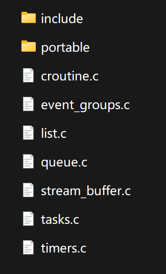有freertos的核心代码，就是这些.c文件，还有include里面的.h文件，prot目录下是和编译器和架构相关的文件，移植的时候需要根据你的芯片和编译器选择，这里面着重看一下怎么选，我是keil，所以keil文件是必须的，然后看一下MemMang文件和RVDS文件，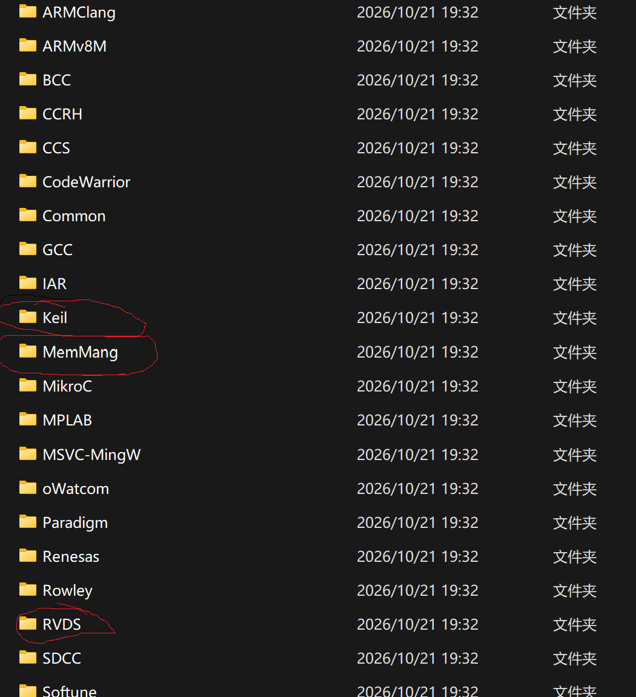

### 3.1 MemMang 目录（堆内存管理）
MemMang文件下是这些东西，主要是freertos的堆内存管理的不同实现，选择heap_4.c即可，详细的可以点开里面的ReadMe去看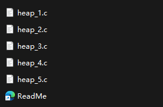

### 3.2 RVDS 目录（芯片相关移植层）
RVDS文件下是和芯片有关的，根据芯片型号来选，里面就是`port.c`和`portmacro.h`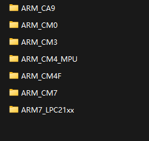

### 3.3 获取 FreeRTOSConfig.h
除了这些文件，freertos还需要一个FreeRTOSConfig.h，在下载的源码中看看文件里面有没有Demo文件，如果没有的话可以去`https://github.com/FreeRTOS/FreeRTOS/blob/main/FreeRTOS/Demo`下载，我的环境是keil和f4，所以选择Demo文件里面CORTEX_M4F_CEC1302_Keil_GCC这个文件下面的FreeRTOSConfig.h文件

## 四、添加源码到 Keil 工程
下面开始添加源码到keil工程里面，在你准备的工程里面创建一个存放freertos的文件夹，里面放进去freertos的源码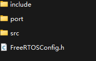

### 4.1 文件结构
大致的文件结构是
```
 freertos/
  ├── FreeRTOSConfig.h          # FreeRTOS 内核配置文件
  ├── include/                  # 公共头文件
  │   ├── CMakeLists.txt
  │   ├── FreeRTOS.h
  │   ├── StackMacros.h
  │   ├── atomic.h
  │   ├── croutine.h
  │   ├── deprecated_definitions.h
  │   ├── event_groups.h
  │   ├── list.h
  │   ├── message_buffer.h
  │   ├── mpu_prototypes.h
  │   ├── mpu_syscall_numbers.h
  │   ├── mpu_wrappers.h
  │   ├── newlib-freertos.h
  │   ├── picolibc-freertos.h
  │   ├── portable.h
  │   ├── projdefs.h
  │   ├── queue.h
  │   ├── semphr.h
  │   ├── stack_macros.h
  │   ├── stream_buffer.h
  │   ├── task.h
  │   └── timers.h
  ├── port/                     # 目标平台移植层
  │   ├── See-also-the-RVDS-directory.txt #Keil文件夹里面的文件
  │   ├── heap_4.c              # 内存堆实现（heap_4）
  │   ├── port.c                # 移植层主文件
  │   └── portmacro.h           # 移植层宏定义
  └── src/                      # 内核源码
      ├── event_groups.c
      ├── list.c
      ├── queue.c
      ├── stream_buffer.c
      ├── tasks.c
      └── timers.c
```
### 4.2 加入工程与路径配置
接着添加文件到keil的工程里面，FreeRTOSConfig.h也加进去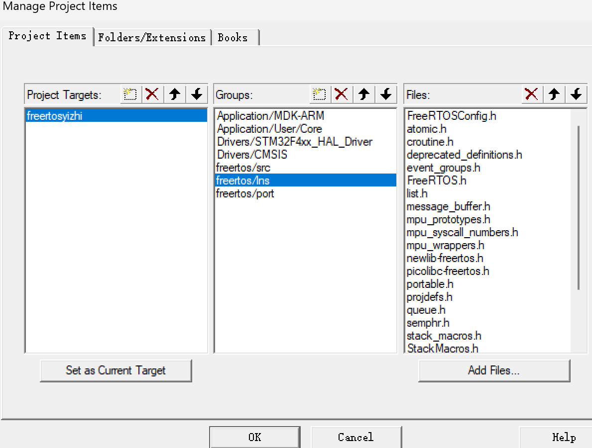
然后添加路径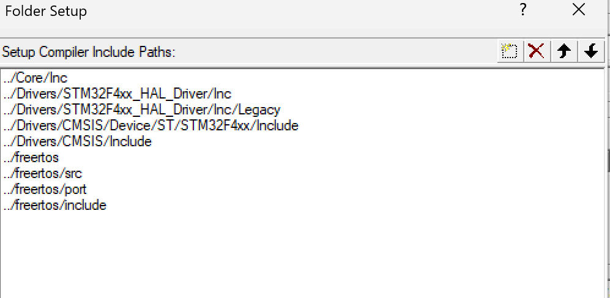

## 五、两种移植方式概述
下面介绍两种移植的方式，大差不差，总体来说就是让freertos接管原本芯片的，SVC，pensv，还有SysTick，主要起作用的是这个三个宏定义，
```
#define xPortPendSVHandler PendSV_Handler
#define vPortSVCHandler SVC_Handler
 #define xPortSysTickHandler SysTick_Handler
```

## 六、第一种移植方式
下面是第一种
接着编译，如果是和我一样的芯片和编译器的话，应该是只有三个error，我们需要去stm32f4xx_it.c里面去把`SVC_Handler``PendSV_Handler``SysTick_Handler`删掉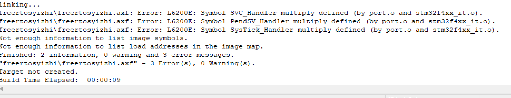

### 6.1 处理编译报错
接着再次编译，会发现有很多报错，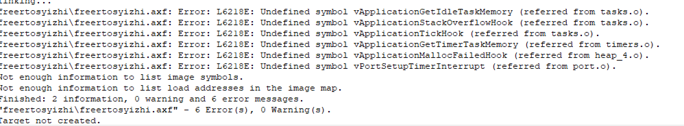

这是因为你在FreeRTOSConfig.h将这些函数的宏定义设为非0，然后却没有这些函数的实现，所以接下来需要把这些函数的宏定义设为0，根据报错一一对应设就行，还有记得把`configCPU_CLOCK_HZ!`改成( SystemCoreClock )，`configTICK_RATE_HZ`改成1000（如果发现一些程序慢了很多，可能就是这里没有改），如果报错`Undefined symbol SystemCoreClock`，在文件里面添加下面代码即可（好奇怪，我第一次移植的时候出现这个报错，写这篇文章时候同样的FreeRTOSConfig.h就没有出现这个报错）
```c
#if defined(__ICCARM__) || defined(__CC_ARM) || defined(__ARMCC_VERSION) || defined(__GNUC__)
    #include <stdint.h>
    extern uint32_t SystemCoreClock;
#endif
```

这样编译之后应该是不会报错，接着在main.c里面写一个LED闪烁任务测试一下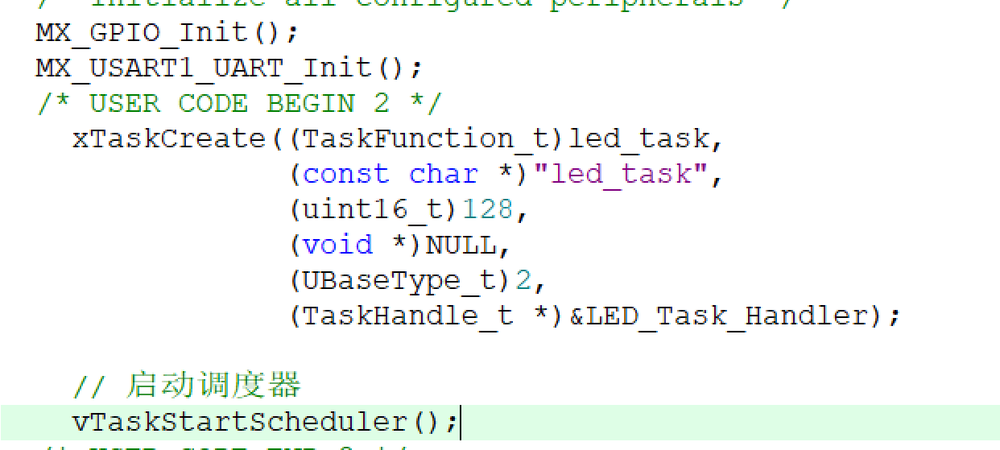

### 6.2 测试与 HardFault 问题排查
烧录后你会发现LED不闪烁，于是你开始调试，发现程序会卡死在HardFault_Handler的wile循环里面，这个原因是之前我们是直接删除了stm32f4xx_it.c文件的`SysTick_Handler`，有么有注意到之前的SysTick_Handler函数里面有一个`HAL_IncTick();`函数，他就是为HAL库提供延时的函数，删除了它,HAL在调用一些和SysTick相关代码就会卡死

### 6.3 解决方法：更换时钟基准
解决方法也很简单，就是将stm32的时钟基准换成其他定时器，这样既能解决当前问题，有避免了freertos和芯片抢SysTick（注意：CubeMx重新生成程序会让stm32f4xx_it.c之前的三个函数回来，记得重新删除，好麻烦，但是我不知道怎么解决）之后再烧录就成功了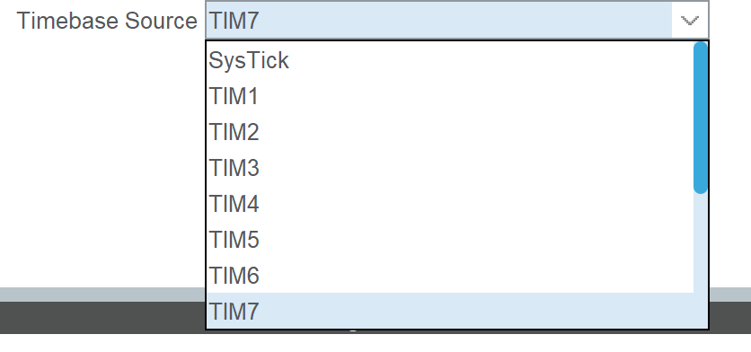

## 七、第二种移植方式
下面来看第二种

和第一种一样，编译会显示三个重定义的error，和第一种不一样的是，FreeRTOSConfig.h文件里面#define xPortSysTickHandler SysTick_Handler需要注释掉,还需要把stm32f4xx_it.c里把`SVC_Handler``PendSV_Handler`这两个删除，然后重定向SysTick_Handler，因为stm32默认会使用系统滴答，然后freertos默认使用的也是系统滴答，会冲突，所以我们提前把stm32的时钟基准改成定时器7（这里如果不改的话，程序大概率会卡在HaedFault），需要让freertos使用SysTick，然后在stm32f4xx_it.c文件头部包含freertos的头文件，把xPortSysTickHandler();声明出去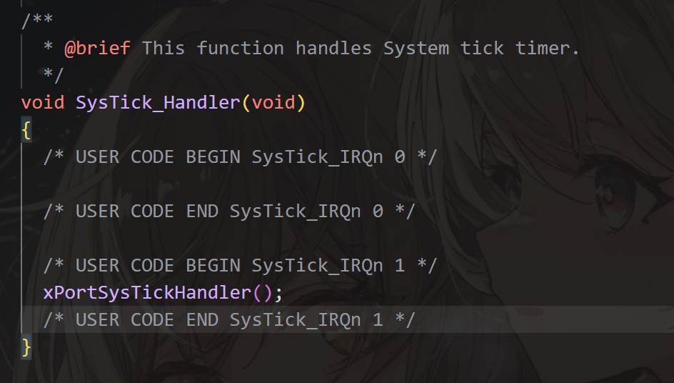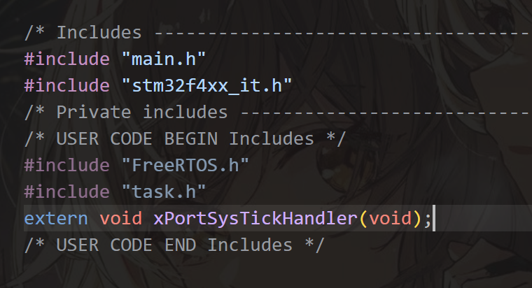
其他操作和第一步就一样了的


简单来说，两种方式的差别只有
```
保留宏 #define xPortSysTickHandler SysTick_Handler，删掉 stm32f4xx_it.c 的 SysTick_Handler

注释宏，在 stm32f4xx_it.c 的 SysTick_Handler 里 #include 头文件后调 xPortSysTickHandler()
```
## 八、常见问题及解决办法


| 报错/现象 |解决办法 |
|-----------|----------|
|`Undefined symbol SystemCoreClock`|FreeRTOSConfig.h添加`extern uint32_t SystemCoreClock`|
| 卡死在`HaedFault`|更改stm32时钟基准为其他定时器 |
|`Undefined symbol vApplicationIdleHook`| FreeRTOSConfig.h中相关宏定义设为0 |
| 程序运行的时间不对（LED闪烁周期变慢） | `configTICK_RATE_HZ`改成1000|

最后是完整的FreeRTOSConfig.h文件
```
#ifndef FREERTOS_CONFIG_H
#define FREERTOS_CONFIG_H

#ifdef __cplusplus
extern "C" {
#endif

#if defined(__ICCARM__) || defined(__CC_ARM) || defined(__ARMCC_VERSION) || defined(__GNUC__)
    #include <stdint.h>
    extern uint32_t SystemCoreClock;
#endif

#define configCREATE_LOW_POWER_DEMO	0	/* 是否构建低功耗演示程序：0=普通演示，1=低功耗演示 */

#if( configCREATE_LOW_POWER_DEMO == 1 )

	#define configTICK_RATE_HZ	( 1000 )	/* 系统节拍频率：1000Hz，即每1ms一个tick */

	#define configUSE_TICKLESS_IDLE		1	/* 启用低功耗tickless空闲模式：1=启用 */

#else

	#define configTICK_RATE_HZ			( 1000 )	/* 系统节拍频率：1000Hz，即每1ms一个tick */

	#define configUSE_TICKLESS_IDLE		0	/* 不启用tickless空闲模式：0=关闭 */

#endif

#define configUSE_PREEMPTION					1	/* 使用抢占式调度器：1=抢占式，0=协作式 */
#define configUSE_PORT_OPTIMISED_TASK_SELECTION	1	/* 使用硬件优化任务选择（如CLZ指令）：1=启用 */
#define configUSE_QUEUE_SETS					1	/* 启用队列集功能：1=启用 */
#define configUSE_IDLE_HOOK						0	/* 启用空闲任务钩子函数：0=不启用 */
#define configUSE_TICK_HOOK						0	/* 启用节拍中断钩子函数：0=不启用 */
#define configCPU_CLOCK_HZ						( SystemCoreClock )	/* CPU主频：取自SystemCoreClock变量 */
#define configMAX_PRIORITIES					( 5 )	/* 最大任务优先级数：5级（0~4） */
#define configMINIMAL_STACK_SIZE				( ( unsigned short ) 120 )	/* 空闲任务最小栈深度（字）：120字 */
#define configTOTAL_HEAP_SIZE					( ( size_t ) ( 26 * 1024 ) )	/* 系统总堆大小：26KB */
#define configMAX_TASK_NAME_LEN					( 10 )	/* 任务名称最大长度（含'\0'）：10字符 */
#define configUSE_TRACE_FACILITY				0	/* 启用可视化跟踪调试：0=不启用 */
#define configUSE_16_BIT_TICKS					0	/* tick计数位宽：0=32位，1=16位 */
#define configIDLE_SHOULD_YIELD					1	/* 空闲任务是否主动让出CPU给同优先级任务：1=是 */
#define configUSE_MUTEXES						1	/* 启用互斥量：1=启用 */
#define configQUEUE_REGISTRY_SIZE				0	/* 队列注册表大小（用于调试）：0=不注册 */
#define configCHECK_FOR_STACK_OVERFLOW			0	/* 栈溢出检测方式：0=不检测，1=方式1，2=方式2 */
#define configUSE_RECURSIVE_MUTEXES				1	/* 启用递归互斥量：1=启用 */
#define configUSE_MALLOC_FAILED_HOOK			0	/* 启用内存分配失败钩子函数：0=不启用 */
#define configUSE_APPLICATION_TASK_TAG			0	/* 启用任务标签功能：0=不启用 */
#define configUSE_COUNTING_SEMAPHORES			1	/* 启用计数信号量：1=启用 */

#define configGENERATE_RUN_TIME_STATS	0	/* 启用运行时统计信息收集：0=不启用 */
#define portCONFIGURE_TIMER_FOR_RUN_TIME_STATS()	/* 配置运行时统计定时器的宏（空实现） */
#define portGET_RUN_TIME_COUNTER_VALUE()			/* 获取运行时统计计数值的宏（空实现） */

#define configUSE_STATS_FORMATTING_FUNCTIONS	0	/* 启用统计格式化函数（vTaskList等）：0=不启用 */

#define configUSE_CO_ROUTINES			 0	/* 启用协程功能：0=不启用 */
#define configMAX_CO_ROUTINE_PRIORITIES ( 2 )	/* 协程最大优先级数：2级 */

#define configUSE_TIMERS				1	/* 启用软件定时器：1=启用 */
#define configTIMER_TASK_PRIORITY		( configMAX_PRIORITIES - 1 )	/* 软件定时器服务任务优先级：最高优先级-1 */
#define configTIMER_QUEUE_LENGTH		5	/* 软件定时器命令队列长度：5个元素 */
#define configTIMER_TASK_STACK_DEPTH	( configMINIMAL_STACK_SIZE )	/* 软件定时器服务任务栈深度：同最小栈120字 */

#define INCLUDE_vTaskPrioritySet		1	/* 包含vTaskPrioritySet()函数：1=包含 */
#define INCLUDE_uxTaskPriorityGet		1	/* 包含uxTaskPriorityGet()函数：1=包含 */
#define INCLUDE_vTaskDelete				1	/* 包含vTaskDelete()函数：1=包含 */
#define INCLUDE_vTaskCleanUpResources	1	/* 包含vTaskCleanUpResources()函数：1=包含 */
#define INCLUDE_vTaskSuspend			1	/* 包含vTaskSuspend()/vTaskResume()函数：1=包含 */
#define INCLUDE_vTaskDelayUntil			1	/* 包含vTaskDelayUntil()函数：1=包含 */
#define INCLUDE_vTaskDelay				1	/* 包含vTaskDelay()函数：1=包含 */
#define INCLUDE_eTaskGetState			1	/* 包含eTaskGetState()函数：1=包含 */
#define INCLUDE_xTimerPendFunctionCall	1	/* 包含xTimerPendFunctionCall()函数：1=包含 */

#ifdef __NVIC_PRIO_BITS
	#define configPRIO_BITS		       __NVIC_PRIO_BITS	/* 优先级位数：由CMSIS的__NVIC_PRIO_BITS决定 */
#else
	#define configPRIO_BITS		       4
#endif

#define configLIBRARY_LOWEST_INTERRUPT_PRIORITY			0x7	/* 库级最低中断优先级值：0x7（数值越大优先级越低） */

#define configLIBRARY_MAX_SYSCALL_INTERRUPT_PRIORITY	5	/* 库级最高系统调用中断优先级：5，高于此优先级的中断不能调用FreeRTOS API */

#define configKERNEL_INTERRUPT_PRIORITY		 ( configLIBRARY_LOWEST_INTERRUPT_PRIORITY << (8 - configPRIO_BITS) )	/* 内核中断优先级（PendSV/SysTick）：最低优先级 */
#define configMAX_SYSCALL_INTERRUPT_PRIORITY	 ( configLIBRARY_MAX_SYSCALL_INTERRUPT_PRIORITY << (8 - configPRIO_BITS) )	/* 最高系统调用中断优先级（寄存器值）：5<<5=0xA0 */

#define xPortPendSVHandler PendSV_Handler	/* 将FreeRTOS的PendSV处理函数映射到CMSIS标准名PendSV_Handler */
#define vPortSVCHandler SVC_Handler	/* 将FreeRTOS的SVC处理函数映射到CMSIS标准名SVC_Handler */
// #define xPortSysTickHandler SysTick_Handler	/* 将FreeRTOS的SysTick处理函数映射到CMSIS标准名SysTick_Handler（已注释，由用户自行实现） */

#define configASSERT( x ) if( ( x ) == 0UL ) { taskDISABLE_INTERRUPTS(); for( ;; ); }	/* 断言宏：条件为假时关闭中断并死循环 */

#define configTOGGLE_LED()	ulLED++	/* LED翻转宏：当前仅递增ulLED计数器模拟LED翻转 */


#ifdef __cplusplus
}
#endif
#endif /* FREERTOS_CONFIG_H */
```